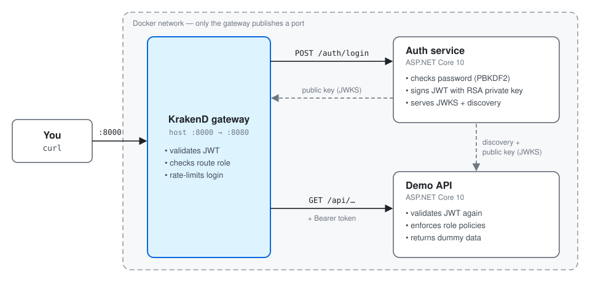

# API Gateway Demo — JWT Authentication & Authorization


A small, hands-on demo of how an API gateway, an auth service and a backend API work together. A KrakenD gateway checks JWTs and roles at the edge. A .NET auth service issues the tokens, and a .NET demo API checks them a second time. Everything runs with one `docker compose` command.

---

## Features

- **Single entry point**: only the gateway publishes a port. The auth service and the API can't be reached from outside Docker.
- **Authentication**: the auth service checks PBKDF2-hashed passwords and issues RS256-signed JWTs. It builds the JWT by hand so you can see exactly how one is made.
- **Authorization**: the gateway and the API both enforce role-based access (`reader`, `admin`).
- **Defense in depth**: the API re-validates every token, so a misrouted request that skips the gateway is still rejected.
- **Public-key trust**: signing keys are published at `/.well-known/jwks.json`. No shared secrets.
- **Login rate limiting**: the gateway throttles brute-force attempts on `/auth/login`.
- **Persistent signing key**: the RSA key is stored in a Docker volume, so tokens survive restarts.

---

## Tech Stack

| Piece | Tech | License | Job |
|---|---|---|---|
| Gateway | KrakenD 3.0 | Apache 2.0 | Single entry point; rejects bad tokens and wrong roles at the edge; rate-limits login |
| Auth service | ASP.NET Core 10 (.NET 10, Alpine image) | MIT | **Authentication**: verifies passwords, issues signed tokens that say who you are and which roles you have |
| Demo API | ASP.NET Core 10 (.NET 10, Alpine image) | MIT | Dummy business endpoints; **authorization** with role policies |

---

## Quick Start

### Prerequisites

- Docker with Compose v2
- `curl` and `jq` (for the examples below)
- .NET 10 SDK, only if you want to build the services outside Docker

### Run it

**Clone the repository**
```bash
git clone https://github.com/alambrecht/apigatewaydemo.git
cd apigatewaydemo
```

**Start everything**
```bash
docker compose up -d --build   # build and start everything in the background
docker compose logs -f gateway # follow the gateway logs
docker compose down            # stop (add -v to also delete the signing key)
```

The gateway is available at http://localhost:8000.

> [!NOTE]
> The gateway may restart once or twice while the auth service starts up. That's expected: it can't start until the auth service is serving its public keys.
>
> On startup the gateway logs `header propagation is disabled because there is no propagate_claims attribute` for each protected route. This is harmless. The gateway doesn't forward token claims as headers because the API reads the token itself.

---

## Repository Structure

```bash
/apigatewaydemo
├── /auth
│   ├── Program.cs           # Login endpoint, token claims, discovery + JWKS endpoints
│   ├── SigningKey.cs        # RSA key load/create, JWT construction and signing
│   ├── UserStore.cs         # In-memory users with PBKDF2-hashed passwords
│   └── Dockerfile
├── /api
│   ├── Program.cs           # JwtBearer setup, role policies, dummy endpoints
│   └── Dockerfile
├── /gateway
│   └── krakend.json         # Routes, token validation, role checks, login rate limit
│                            # (KrakenD 3 config format: "version": 4)
├── /docs
│   └── architecture.svg     # Architecture diagram
├── docker-compose.yml       # Wires the three services + the auth-keys volume
├── API.md                   # Full endpoint reference
└── README.md
```

Each service folder also has a `.dockerignore` that keeps local `bin/` and `obj/` out of the image builds.

---

## Architecture Overview



### How the pieces trust each other

1. The auth service generates an RSA key pair on first start and saves the private key to the `auth-keys` volume (`chmod 600`), so tokens survive restarts.
2. `/login` builds a JWT by hand (see `auth/SigningKey.cs`): `base64url(header).base64url(payload)`, signed with RS256 using the private key. Reading that file is the best way to see what a JWT really is.
3. The **public** key is published at `/.well-known/jwks.json`. Neither KrakenD nor the API ever sees the private key or shares a secret.
4. KrakenD fetches the JWKS and checks signature, `iss`, `aud`, `exp` and the route's required role.
5. The demo API reads `/.well-known/openid-configuration` (a minimal one the auth service serves) to find the same keys, and checks everything again with ASP.NET Core's standard `JwtBearer` handler.

---

## API Endpoints

All requests go through the gateway at `http://localhost:8000`. Full reference: [API.md](API.md).

| Endpoint | Method | Auth | Required role | Description |
|---|---|---|---|---|
| `/auth/login` | POST | none | — | Exchange a username and password for an access token |
| `/api/public` | GET | none | — | Public endpoint |
| `/api/me` | GET | Bearer token | any | Show the identity inside your token |
| `/api/items` | GET | Bearer token | `reader` | List items |
| `/api/admin/stats` | GET | Bearer token | `admin` | Admin statistics |

### Test users

Defined in `auth/UserStore.cs`:

| Username | Password | Roles |
|---|---|---|
| `alice` | `alice` | `reader` |
| `bob` | `bob` | `reader`, `admin` |

---

## Try It

```bash
# Public — no token → 200
curl -i http://localhost:8000/api/public

# Protected without a token → 401 (stopped at the gateway)
curl -i http://localhost:8000/api/items

# Log in as alice (AUTHENTICATION)
ALICE=$(curl -s -X POST http://localhost:8000/auth/login \
  -H "Content-Type: application/json" \
  -d '{"username":"alice","password":"alice"}' | jq -r .access_token)

curl -i -H "Authorization: Bearer $ALICE" http://localhost:8000/api/me           # 200 — shows your claims
curl -i -H "Authorization: Bearer $ALICE" http://localhost:8000/api/items        # 200 — alice is a reader
curl -i -H "Authorization: Bearer $ALICE" http://localhost:8000/api/admin/stats  # 403 — not an admin (AUTHORIZATION)

# Log in as bob
BOB=$(curl -s -X POST http://localhost:8000/auth/login \
  -H "Content-Type: application/json" \
  -d '{"username":"bob","password":"bob"}' | jq -r .access_token)

curl -i -H "Authorization: Bearer $BOB" http://localhost:8000/api/admin/stats    # 200

# Wrong password → 401
curl -i -X POST http://localhost:8000/auth/login -H "Content-Type: application/json" \
  -d '{"username":"bob","password":"nope"}'
```

Paste a token into https://jwt.io to see its header (`alg`, `kid`) and payload (`iss`, `aud`, `sub`, `roles`, `exp`).

### Things to try

- **Forge a token.** Decode alice's token, change `roles` to `["admin"]`, re-encode it and send it. The signature no longer matches, so you get a 401.
- **Bypass the gateway** (simulates a misconfigured network): `docker compose exec gateway wget -qO- http://api:8080/items`. The API still answers 401, because it checks tokens itself.
- **Hammer the login.** Each IP gets a burst of 3 login attempts, then 2 per second. Past that, the gateway answers 429 Too Many Requests. Failed logins are deliberately slow (password hashing), so send them in parallel or quickly to hit the limit.

---

## Environment Variables

Set in `docker-compose.yml`:

| Service | Variable | Value | Description |
|---|---|---|---|
| auth | `Auth__Issuer` | `http://auth:8080` | Goes into every token's `iss` |
| auth | `Auth__Audience` | `demo-api` | Goes into every token's `aud` |
| auth | `Auth__TokenMinutes` | `15` | Token lifetime |
| auth | `Auth__KeyPath` | `/keys/signing-key.pem` | Where the private signing key is stored |
| api | `Auth__Authority` | `http://auth:8080` | Where to find discovery + public keys |
| api | `Auth__Audience` | `demo-api` | Audience the API expects |

---

## Learning-Only Shortcuts (Don't Ship These)

- Plain HTTP everywhere (`RequireHttpsMetadata = false`, `disable_jwk_security`). Put TLS on the gateway.
- Users are hard-coded in memory. Real version: a SQL Server table via ASP.NET Core Identity + EF Core.
- No refresh tokens, so you log in again every 15 minutes. No revocation either: a stolen token works until it expires.
- No account lockout or MFA (the gateway rate limit is the only brute-force protection).
- One signing key, no rotation. The `kid` header is already there so you can publish two keys during a rotation.
- Hand-rolled JWT creation is great for learning. In production, prefer a maintained library (`Microsoft.IdentityModel.JsonWebTokens`) or a full framework (OpenIddict, Duende IdentityServer).
